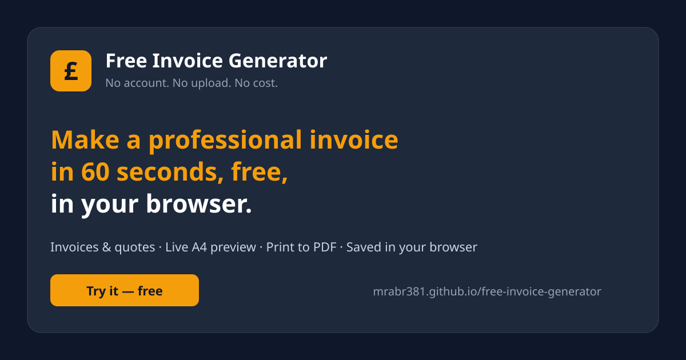
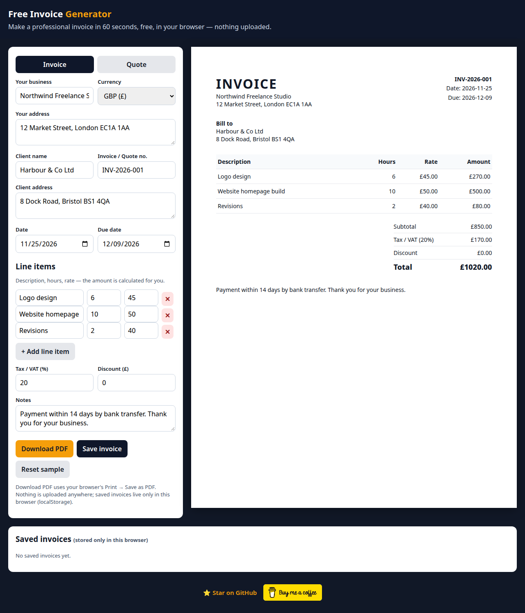
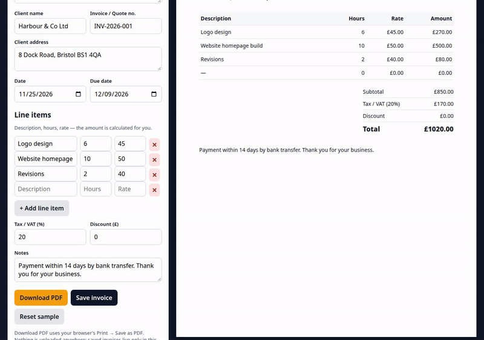

[](https://github.com/mrabr381/free-invoice-generator)
[](https://www.buymeacoffee.com/muhammadabubakar)

# Free Invoice Generator

**Make a professional invoice in 60 seconds, free, in your browser — nothing uploaded.**

**Live demo:** https://mrabr381.github.io/free-invoice-generator/



*The sample invoice: three line items, 20% VAT, £1,020.00 total — rendered live as you type.*



## What it is

A focused, private invoice and quote maker. Type your client and line
items, watch a proper A4 invoice render live, then print it to PDF.
No account, no sign-up, no server — your data never leaves your browser.

## How to use it

1. Open the demo link above (or open `index.html` in any browser).
2. The sample invoice is already filled in — edit the client, dates
   and line items, or click **Reset sample** to start from it again.
3. Add line items: description, hours, rate. Totals, tax/VAT and the
   grand total update live.
4. Switch **Invoice / Quote** at the top to relabel the document.
5. Click **Download PDF** — your browser's print dialog saves it as PDF.
6. Click **Save invoice** to keep it in this browser; reload it later
   from the Saved invoices list, or delete it there.

## Why this instead of a paid tool?

FreshBooks Lite costs $23/month. Wave offers free invoicing as part of
a full accounting suite. This is the opposite: one focused job, no
account, no upload, no subscription — just an invoice.

## What it does

- Live A4 invoice preview as you type
- Line items (description, hours, rate) with automatic totals
- Tax / VAT % and flat discount
- Invoice mode and Quote mode (same form, labelled QUOTE)
- Download PDF via print CSS (works offline, no library needed)
- Save / load / delete invoices in browser localStorage
- GBP, USD and EUR

## Honest limits

- PDF is made through your browser's Print → Save as PDF, so the
  exact look depends on your browser's print settings.
- Saved invoices live only in this browser's localStorage. Clear
  your browser data and they are gone; there is no cloud backup
  or sync between devices.
- No tax advice: the VAT % is whatever you type in, and totals are
  rounded to 2 decimal places.
- No sending: it makes the invoice, it does not email it to clients.
- Sample data (Northwind Freelance Studio / Harbour & Co Ltd) is
  fictional, for demo purposes only.

## Run it locally

```bash
python3 -m http.server 8000
# open http://localhost:8000
```

No build step, no server, no keys, no dependencies to install.

## Tests

```bash
npm test
```

Node tests (`tests/invoice.test.js`, `node:test`) cover the invoice
maths: line totals, subtotal, tax/VAT, grand total, discount, quote
vs invoice labelling, currency formatting and item validation.
CI runs them on every push (`.github/workflows/ci.yml`).

## Files

- `index.html` — the whole tool (form + A4 preview + print CSS)
- `invoice.js` — pure invoice maths, shared by the page and tests
- `app.js` — form wiring, live preview, localStorage saves
- `assets/hero.svg` — banner image
- `tests/invoice.test.js` — test suite

## License

MIT.
